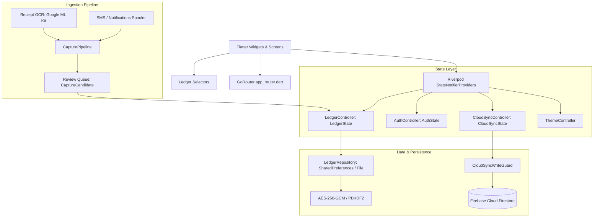

# 1Wallet Architecture Skill

This skill guides an AI agent through navigating, designing, and maintaining the 1Wallet Flutter and PWA codebase.

## System Topology

## Architectural Guidelines

1. **State Isolation**: UI components never write directly to storage or Firestore. All writes flow through `ledgerProvider.notifier` methods (`addRecord`, `updateRecord`, `deleteRecord`, `addAccount`, etc.).
2. **Derived Data via Selectors**: Calculated values such as account balances, net worth, and spending by category are computed via memoized selectors in `lib/src/ledger/ledger_selectors.dart`.
3. **Double-Entry Representation**: Transfers between two accounts are modeled as a transaction with `accountId` (source) and `counterAccountId` (destination). Both account balances update in an atomic step.
4. **Minor Units for Financial Calculations**: Never use floating point math for currency amounts. All amounts are stored as integer `amountMinor` (1.00 USD = 100 minor units).
