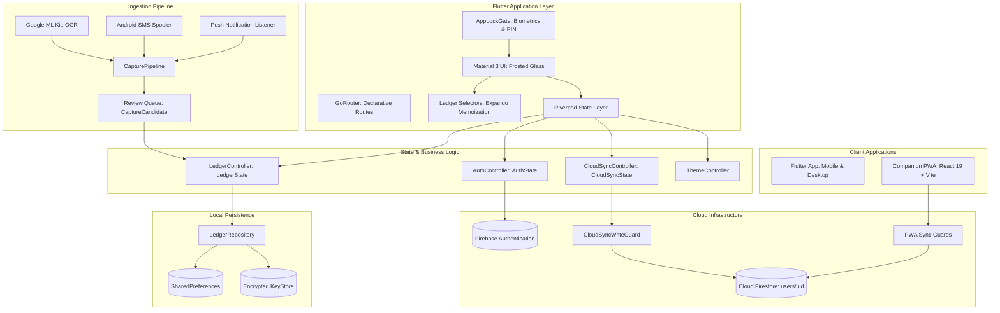

# 1Wallet — System Architecture & Design Blueprint

## 🏛️ Executive Summary

**1Wallet** is an offline-first, privacy-centric personal wealth management application. It runs natively across mobile (Android, iOS) and desktop (Windows, macOS, Linux) via Flutter, accompanied by a companion Progressive Web App (React 19 + TypeScript + Vite) and backed by Google Cloud Firebase services.

The system is built on four core architectural pillars:
1. **Mathematical Determinism**: Financial amounts are strictly integer minor units (`amountMinor`). Transfers and multi-currency balances follow deterministic double-entry principles.
2. **Offline-First Autonomy**: The client never blocks on network connectivity. All operations mutate local state immediately, with optimistic background synchronization to Cloud Firestore.
3. **End-to-End Local Security**: Encrypted backups (AES-256-GCM / PBKDF2), biometric hardware authentication (`local_auth`), and zero-leakage security gates.
4. **Intelligent On-Device Ingestion**: On-device machine learning (Google ML Kit Text Recognition) and heuristic regex engines parse unstructured bank SMS and receipt images without third-party cloud data extraction.

---

## 🗺️ System Topology



---

## 💎 Core Architectural Decisions

### 1. Currency Representation: Integer Minor Units
To eliminate binary floating-point representation errors (e.g. `0.1 + 0.2 = 0.30000000000000004`), every monetary value throughout the system is represented as:
```dart
@immutable
class Money {
  const Money({required this.amountMinor, required this.currency});
  final int amountMinor; // e.g. 1550 for $15.50 or ¥1550 for JPY
  final String currency; // ISO-4217 code (USD, EUR, INR)
}
```
All conversions, summaries, and calculator operations operate in integer minor units until final string formatting for display.

### 2. State Management & Selectors
State is managed via `flutter_riverpod` using immutable state classes:
- **`LedgerState`**: Single root state object holding all accounts, categories, transactions, recurring rules, exchange rates, and capture candidates.
- **`ledger_selectors.dart`**: Pure query functions calculating balances, flows, and net worth. Selectors leverage Dart's `Expando` keyed on `LedgerState` instance identity, enabling instant $O(1)$ cache hits during UI re-renders without re-sorting or re-summing transaction lists.

### 3. Double-Entry Transfer Modeling
Internal transfers between accounts are modeled as a single transaction containing:
- `accountId`: Source account deducted by `amountMinor`.
- `counterAccountId`: Destination account credited by `transferDestinationAmountMinor` (or equivalent converted value).
This guarantees balance integrity across accounts without maintaining divergent linked record pairs.

### 4. Offline-First Cloud Synchronization
Synchronization with Firebase Firestore follows an optimistic document snapshot strategy:
1. Local edits update in-memory `LedgerState` and persist to disk immediately with `unsyncedChanges = true`.
2. `CloudSyncController` detects connectivity and invokes `CloudSyncWriteGuard`.
3. The guard compares local timestamps and remote revision metadata (`updatedAt`, `schemaVersion`).
4. If valid, the serialized and compressed payload is written to `users/{uid}` in Cloud Firestore.
5. If remote revisions conflict, a merge or user resolution dialog is triggered without destroying data.

### 5. Multi-Layer Security Architecture
- **Biometric Gate (`AppLockGate`)**: Wraps the root navigation tree. Screen contents are obfuscated when the OS app switcher is invoked.
- **Hardware-Backed KeyStore**: Master encryption keys are stored via `flutter_secure_storage` using Android Keystore and iOS Keychain.
- **Export Encryption**: Wallet backup files are encrypted using `AES-256-GCM` with cryptographic keys derived via `PBKDF2` (100,000+ iterations with unique salt and initialization vector).

---

## 🌐 Companion PWA Architecture
The companion web app in `pwa/` provides seamless browser-based access:
- **React 19 & TypeScript**: High-performance functional components and hooks (`useAuth`, `useWalletData`).
- **Codec Parity**: `pwa/src/lib/ledgerCodec.ts` and `pwa/src/lib/walletSyncGuards.ts` mirror the Flutter engine's encoding and conflict detection logic, ensuring 100% interoperability with Firestore snapshots created by mobile clients.
