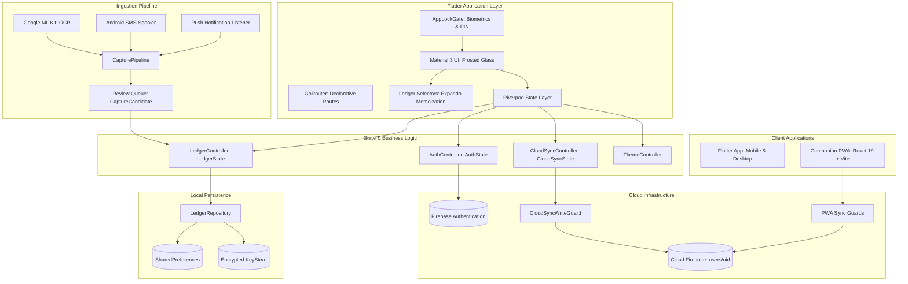

# 1Wallet — System Architecture & Design Blueprint

## 🏛️ Executive Summary

**1Wallet** is an offline-first, privacy-centric personal wealth management application. It runs natively across mobile (Android, iOS) and desktop (Windows, macOS, Linux) via Flutter, accompanied by a companion Progressive Web App (React 19 + TypeScript + Vite) and backed by Google Cloud Firebase services.

The system is built on four core architectural pillars:
1. **Mathematical Determinism**: Financial amounts are strictly integer minor units (`amountMinor`). Transfers and multi-currency balances follow deterministic double-entry principles.
2. **Offline-First Autonomy**: The client never blocks on network connectivity. All operations mutate local state immediately, with optimistic background synchronization to Cloud Firestore.
3. **End-to-End Local Security**: Encrypted backups (AES-256-GCM / PBKDF2), biometric hardware authentication (`local_auth`), and zero-leakage security gates.
4. **Intelligent On-Device Ingestion**: On-device machine learning (Google ML Kit Text Recognition) and heuristic regex engines parse unstructured bank SMS and receipt images without third-party cloud data extraction.

---

## 🗺️ System Topology



---

## 💎 Core Architectural Decisions

### 1. Currency Representation: Integer Minor Units
To eliminate binary floating-point representation errors (e.g. `0.1 + 0.2 = 0.30000000000000004`), every monetary value throughout the system is represented as:
```dart
@immutable
class Money {
  const Money({required this.amountMinor, required this.currency});
  final int amountMinor; // e.g. 1550 for $15.50 or ¥1550 for JPY
  final String currency; // ISO-4217 code (USD, EUR, INR)
}
```
All conversions, summaries, and calculator operations operate in integer minor units until final string formatting for display.

### 2. State Management & Selectors
State is managed via `flutter_riverpod` using immutable state classes:
- **`LedgerState`**: Single root state object holding all accounts, categories, transactions, recurring rules, exchange rates, and capture candidates.
- **`ledger_selectors.dart`**: Pure query functions calculating balances, flows, and net worth. Selectors leverage Dart's `Expando` keyed on `LedgerState` instance identity, enabling instant $O(1)$ cache hits during UI re-renders without re-sorting or re-summing transaction lists.

### 3. Double-Entry Transfer Modeling
Internal transfers between accounts are modeled as a single transaction containing:
- `accountId`: Source account deducted by `amountMinor`.
- `counterAccountId`: Destination account credited by `transferDestinationAmountMinor` (or equivalent converted value).
This guarantees balance integrity across accounts without maintaining divergent linked record pairs.

### 4. Offline-First Cloud Synchronization
Synchronization with Firebase Firestore follows an optimistic document snapshot strategy:
1. A serialized ledger lane derives edits from current state, records the dirty
   marker before notification, advances the local revision at publication, and
   persists a versioned local envelope. Preference disk work remains debounced.
2. Session generations fence queued work, account changes, async completions,
   listeners, and teardown. A late save cannot recreate a cleared session.
3. Upload captures one ledger/local revision and compares the remote
   `cloudRevision`/`updatedAt` baseline inside a Firestore transaction.
4. Metadata plus compressed `wallet_backups/chunk_N` writes/deletes commit
   atomically. Completion acknowledges only the exact uploaded local revision;
   newer local edits remain dirty and trigger another check.
5. A version-consistent modern restore is authoritative even when empty.
   Transaction dates/counts cannot veto legitimate remote deletions. Missing or
   invalid snapshots are distinct from an intentionally cleared wallet.
6. Canonical cloud JSON is not the local persistence envelope or an encrypted
   portable backup. See [the schema and format boundaries](doc/SCHEMA.md).

### 5. Multi-Layer Security Architecture
- **Biometric Gate (`AppLockGate`)**: Wraps navigation, obscures on inactivity,
  relocks on actual background transitions, and rejects stale authentication
  results. OS snapshot and biometric-prompt behavior still require device tests.
- **OS Key Store**: Owner/purpose-scoped AES keys use OS secure storage. Hardware
  backing depends on the platform. Legacy shared keys remain read-compatible.
- **Automatic Backups**: Authenticated device-key encryption in the app-specific
  application-support directory. No automatic public Downloads/Documents
  mirrors; old locations remain discoverable for explicit recovery and cleanup.
- **Portable Backups**: AES-256-GCM with a fresh 96-bit nonce and 128-bit salt,
  PBKDF2-HMAC-SHA256 at the versioned 600,000-iteration profile, and authenticated
  format metadata. Native KDF work runs off the UI isolate. Secure fields are rewrapped
  for cross-device import rather than depending on the exporting device key.
- **Deletion**: A backend job fences writes, removes the owner's complete
  Firestore subtree, and deletes Auth last. The app verifies remote completion
  separately from strict local cleanup; an opaque receipt supports recovery.
  See [the deployment and failure runbook](firebase/functions/README.md).

### 6. Durable Android Capture

SMS and notification producers append to one app-private SQLite queue on a
background executor. Owner and filtering configuration are revisioned together;
an append from an obsolete configuration is rejected. Signed-out capture pauses.
Consumers read without deleting, validate/quarantine individual entries, commit
the ledger with durable local ingress receipts, then acknowledge IDs. Pending
receipts survive restart and prevent duplicate application after an ack failure.
Legacy preference queues migrate idempotently as unassigned entries and require
explicit owner confirmation.

---

## 🌐 Companion PWA Architecture
The companion web app in `pwa/` provides seamless browser-based access:
- **React 19 & TypeScript**: High-performance functional components and hooks (`useAuth`, `useWalletData`).
- **Codec Parity**: `pwa/src/lib/ledgerCodec.ts` and `pwa/src/lib/walletSyncGuards.ts` mirror the Flutter engine's encoding and conflict detection logic, ensuring 100% interoperability with Firestore snapshots created by mobile clients.
