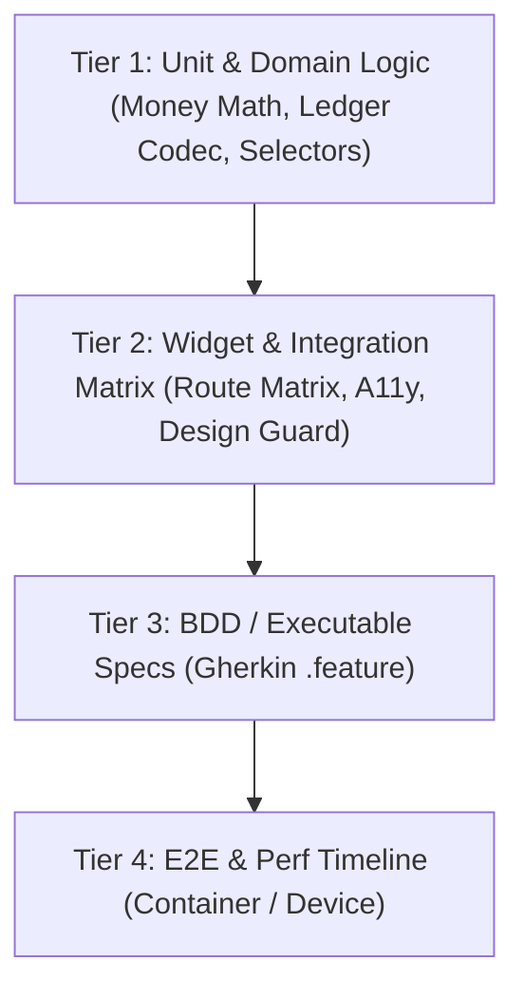

# 1Wallet Engineering Maturity & Operational Blueprint

This document sets the engineering maturity baseline, architectural scorecard, and operational roadmap for the **1Wallet** repository. It defines standards across testing, observability, supply chain security, release engineering, accessibility, and developer experience while preserving the core system invariants.

---

## 🧭 Executive Summary & Core Invariants

1Wallet is an offline-first, privacy-focused, cross-platform personal finance application. Financial applications demand zero tolerance for data corruption, privacy leaks, or unpredictable releases.

### 🛡️ Non-Negotiable System Invariants
1. **Integer Minor Units**: All monetary values are strictly represented in minor units (`amountMinor` as integer). Floating-point (`double`) representations for money calculations are strictly prohibited.
2. **Offline-First Isolation**: The app must be 100% operational in offline mode. No network calls or Firestore operations may execute when offline.
3. **Zero Financial PII Leaks**: Monetary amounts, account numbers, PINs, auth tokens, and transaction notes must never be sent to crash reporters (Crashlytics/Sentry), analytics providers, or remote logs.
4. **Non-Blocking UI Thread**: Disk I/O, PBKDF2/AES cryptographic routines, and synchronization operations must run asynchronously and off the main UI rendering thread.
5. **App Lock Gate Integrity**: `AppLockGate` guards all navigation routes; sensitive financial screens must never render or leak memory before authentication completes.

---

## 📊 Engineering Maturity Scorecard

| Domain | Baseline (v1.x) | Current (v2.x) | Target (v3.0 Maturity) | Status |
| :--- | :--- | :--- | :--- | :--- |
| **Unit & Widget Testing** | Basic model tests | >100 test suites, UI route matrix, design guard | Full pyramid with coverage gates | ✅ Solid |
| **BDD & Executable Specs** | None | Feature specs for offline & money flows | Automated Gherkin test suite in CI | 🔄 Phase 3 |
| **Observability & Logging** | Unstructured `print` / debugPrint | Structured logging façade with PII redaction | Crashlytics + Perf budgets + privacy analytics | 🔄 Phase 4 |
| **Release Engineering** | Manual GitHub Actions scripts | Fastlane pipelines (Android/iOS) | Release-please automated semver + changelogs | 🔄 Phase 5 |
| **Supply Chain Security** | Basic Dependabot | Pinned actions, Gitleaks secret scan, SAST | SBOM generation + License compliance | 🔄 Phase 5 |
| **Architecture & Modularity** | Monolithic `lib/` | Layered architecture + ADRs | Melos monorepo + extracted core packages | 🔄 Phase 6 |
| **Accessibility (a11y)** | Partial semantics tests | Automated `meetsGuideline` contrast/tap checks | Full WCAG 2.1 AA compliance + RTL | 🔄 Phase 6 |
| **i18n Readiness** | Hardcoded strings | ARB scaffolding + locale number formatters | Multi-locale translation pipeline | 🔄 Phase 6 |
| **Developer Experience** | Manual setup | Devcontainer + Lefthook pre-commit hooks | Unified `Makefile` + CI parity | 🔄 Phase 6 |

---

## 📐 Testing Pyramid Architecture

The testing strategy follows a rigorous multi-tier pyramid designed to prevent regressions and catch behavioral issues as early as possible.

### Tier 1: Unit & Domain Tests
- Covers money math, ledger serialization/deserialization, state transitions, regex SMS parsers, and codec backwards compatibility.
- Runs in milliseconds via `flutter test`.

### Tier 2: Component, Widget & UI Matrix Tests
- Validates widget trees, responsive layouts (phone/tablet), dark/light themes, and design system invariants (`ui_design_system_guard_test.dart`).
- Uses `test/test_harness.dart` and `test/test_prefs.dart` for deterministic memory-only execution.

### Tier 3: Executable BDD Specifications
- Business-readable `.feature` files specifying critical money and offline behaviors.
- Backed by step definitions mapped directly into `test_harness.dart` and `offline_mode_fakes.dart`.
- Published as test report artifacts in CI.

### Tier 4: E2E, Jank & Performance Traces
- Automated headless/containerized integration tests using `package:integration_test`.
- Measures UI frame drops, cold startup time, ledger hydration latency, and memory budgets.

---

## 🔍 Observability, Privacy & Telemetry Strategy

### Structured Logging Façade
- Replaces raw `print()` calls with `AppLogger`.
- Log levels: `trace`, `debug`, `info`, `warning`, `error`, `fatal`.
- **Automatic Redaction**: Sanitizes strings using regex patterns to mask currency figures, balance numbers, tokens, and authorization headers before emission.

### Error & Crash Reporting
- Implements `CrashReporter` interface.
- Production: Firebase Crashlytics with release tagging and non-sensitive diagnostic keys.
- Strictly strips any payload field containing financial identifiers or personal data.

### Performance Tracking & Budgets
- Custom `PerformanceTracker` traces for:
  - Cold Start Latency (< 1500ms budget)
  - Ledger Deserialization & Hydration (< 500ms budget)
  - AES-256 Backup Decryption (< 300ms budget)
  - Cloud Sync Commit (< 800ms budget)

### Privacy-Preserving Analytics
- Explicitly opt-in via user preferences.
- Zero financial amounts, account labels, or user notes are accepted.
- Events are restricted to feature usage telemetry (e.g. `export_backup_completed`, `view_category_screen`).

---

## 🚀 Release Engineering & Supply Chain Security

### Fastlane Deployment Pipeline
- Standardized Android (`android/fastlane`) and iOS (`ios/fastlane`) lanes.
- Handles automated keystore injection, artifact signing, metadata validation, and staged rollouts to Google Play Internal/Beta tracks and Apple TestFlight.
- Keeps existing update manifest scripts (`scripts/mobile-update-manifest.mjs`) for in-app updates while eliminating manual release friction.

### Automated Versioning & Semantic Releases
- Conventional Commits (`feat:`, `fix:`, `chore:`, `perf:`, `refactor:`).
- `release-please` integration to automate version bumps in `pubspec.yaml` and maintain `CHANGELOG.md`.

### Supply Chain Hardening
- **Pinned Actions**: All GitHub Actions pinned to immutable 40-character commit SHAs.
- **Secret Scanning**: Gitleaks scanner running in CI on every push and PR.
- **SAST**: GitHub CodeQL for JavaScript/TypeScript functions and strict Dart analyzer rules.
- **SBOM**: Automated Software Bill of Materials generation in SPDX/CycloneDX format for release builds.
- **Dependabot**: Automated dependency monitoring for GitHub Actions, pub, and npm packages.

---

## 🏛️ Architecture Evolution & DevEx

### Monorepo Roadmap (Melos)
- Scaffolds a Melos workspace enabling code extraction without breaking existing apps:
  - `apps/one_wallet_flutter` (Main Flutter app)
  - `pwa/` (React/Vite companion web app)
  - `packages/one_wallet_money` (Zero-dependency integer money math library)
  - `packages/one_wallet_design_system` (Tokens, glass components, and reusable UI)

### Accessibility (a11y) Standards
- Automated testing verifying WCAG 2.1 AA compliance:
  - Minimum tap target sizes (48x48 dp on Android)
  - Contrast ratios (4.5:1 for normal text, 3:1 for large text)
  - Screen reader semantic descriptions on interactive widgets
  - Dynamic-type font scaling (1.0x to 1.5x) and RTL layout mirroring

### Developer Tooling & Ergonomics
- **Devcontainer**: Reproducible development environment container with pinned Flutter SDK, Android CLI tools, and Node.js.
- **Pre-commit Hooks**: Lefthook configuration enforcing `dart format`, `dart analyze`, and unit test checks prior to commit.
- **Standardized Templates**: `CONTRIBUTING.md`, PR templates, issue templates, and `CODEOWNERS`.
- **Makefile**: Single entry point for developer commands (`make test`, `make analyze`, `make bdd`, `make a11y`).
